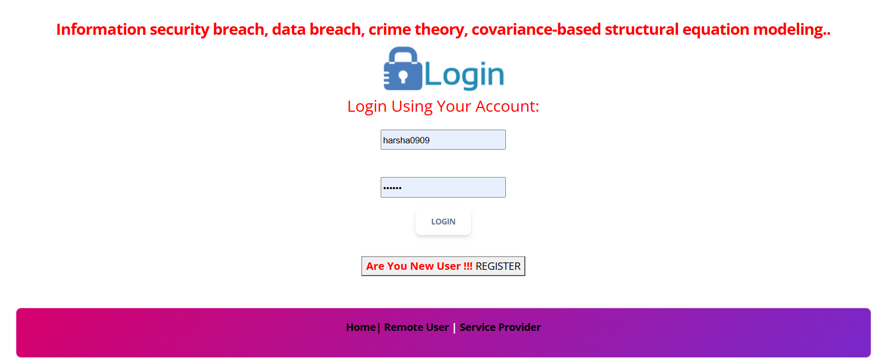
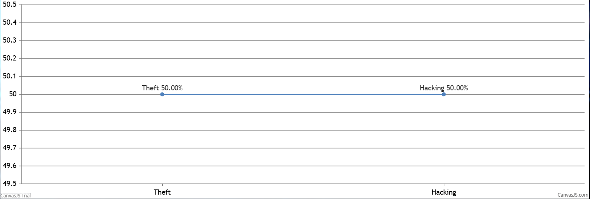
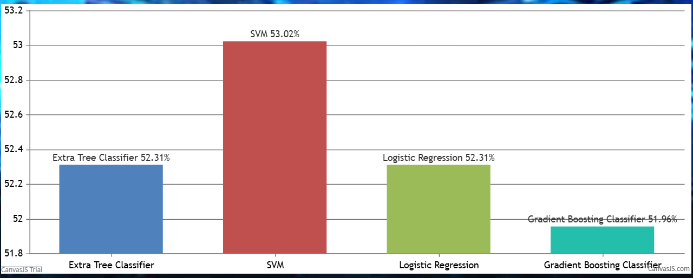
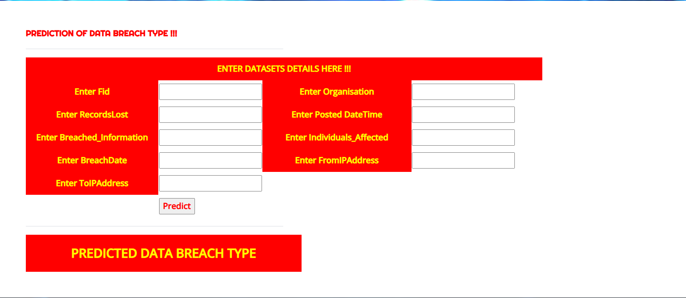

# Assessing Data Breach Factors Through Modern Crime Theory

## Project Overview

This project explores organizational factors associated with data breaches using the **Modern Crime Theory (MCT)** framework.

The study examines three key factors — **Attractiveness, Visibility, and Guardianship** — to understand their relationships with organizational data breach risks.

The project uses organizational data covering **4,868 organizations** and applies data analysis and statistical techniques to examine patterns and relationships associated with data breaches.

A web-based application developed using Django provides user authentication, data analysis, visualization, model performance displays, and prediction-related functionalities.

## Project Objectives

- Analyze organizational factors associated with data breaches.
- Examine the roles of Attractiveness, Visibility, and Guardianship.
- Identify patterns across different types of data breaches.
- Present analytical findings through charts and tables.
- Integrate data analysis and prediction-related functionality into a web application.

## Modern Crime Theory Factors

| Factor | Description |
|---|---|
| Attractiveness | Organizational characteristics that may make an organization a potential target. |
| Visibility | The organization's digital presence and exposure to potential attackers. |
| Guardianship | Security measures and protective capabilities that help prevent data breaches. |

## Technologies Used

- **Programming Language:** Python
- **Backend Framework:** Django
- **Database:** MySQL
- **Data Analysis:** Pandas, NumPy
- **Machine Learning:** Scikit-learn
- **Frontend:** HTML, CSS, JavaScript
- **Version Control:** Git and GitHub

## Project Methodology

1. **Data Collection:** Work with organizational data related to data breach factors.
2. **Data Preprocessing:** Prepare and organize data for analysis.
3. **Exploratory Data Analysis (EDA):** Examine data distributions, patterns, and relationships.
4. **Data Visualization:** Represent analytical findings using charts and tables.
5. **Model Evaluation:** Display model performance results through evaluation tables and visualizations.
6. **Web Application Development:** Integrate application functionalities using Django and MySQL.

## Application Screenshots

### 1. Home Page


### 2. User Login



### 3. User Dashboard


### 4. Data Breach Analysis

**Breach Type Ratio Chart**



**Breach Type Ratio Results**


### 5. Model Performance

**Model Accuracy Bar Chart**



**Model Accuracy Line Chart**


**Model Accuracy Table**


### 6. Prediction Module

**Prediction Input Form**



**Prediction Results**


## Project Structure

```text
assessing-data-breach-analysis/
│
├── Data_Analytics/
├── Remote_User/
├── Service_Provider/
├── Template/
├── assessing_data_breach/
├── Screenshots/
├── manage.py
├── requirements.txt
├── .gitignore
└── README.md
```

*Note: Local dataset and results files are excluded from the GitHub repository.*

## Installation and Setup

### 1. Clone the Repository

```bash
git clone https://github.com/harsha-musalakkagari/assessing-data-breach-analysis.git
cd assessing-data-breach-analysis
```

### 2. Create a Virtual Environment

Python 3.12 is recommended.

```bash
py -3.12 -m venv .venv
```

### 3. Activate the Environment

Windows PowerShell:

```powershell
.\.venv\Scripts\Activate.ps1
```

### 4. Install Dependencies

```bash
python -m pip install -r requirements.txt
```

### 5. Configure Environment Variables

Create a `.env` file in the project root and configure the environment variables required by the Django settings.

Example configuration:

```env
SECRET_KEY=your_django_secret_key
DEBUG=True
DB_NAME=your_database_name
DB_USER=your_database_user
DB_PASSWORD=your_database_password
DB_HOST=localhost
DB_PORT=3306
```

Use the exact variable names expected by the project's `settings.py` file.

**Important:** Never upload your `.env` file, secret