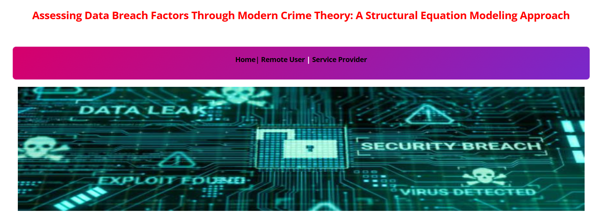
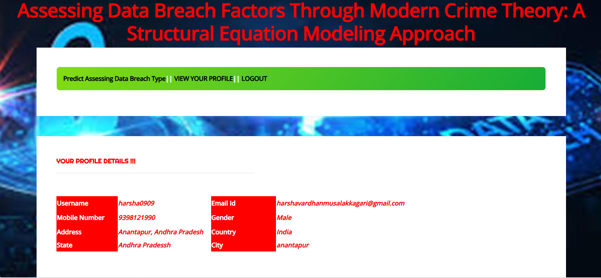
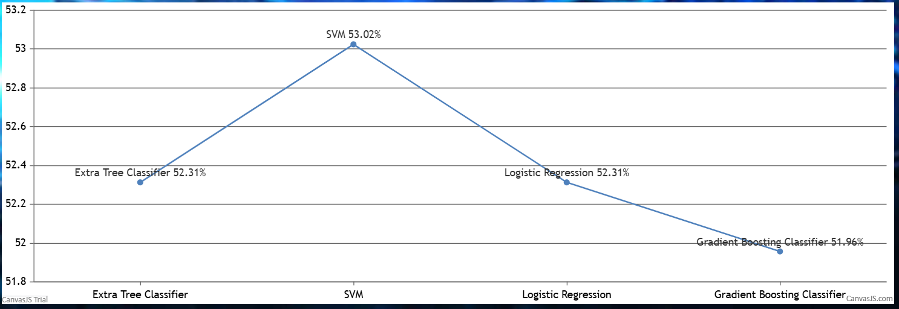
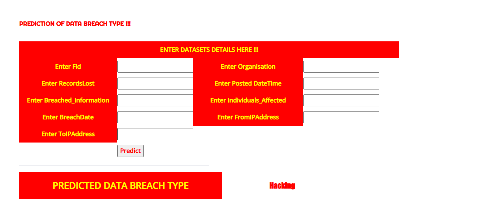

# Assessing Data Breach Factors Through Modern Crime Theory

## Project Overview

This project focuses on analyzing factors associated with organizational data breaches using the Modern Crime Theory (MCT) framework.

The study examines how three major factors — **Attractiveness, Visibility, and Guardianship** — relate to the likelihood of data breaches.

A web-based application developed using Django provides user authentication, data analysis, visualization, and prediction-related functionalities.

The research considers organizational data covering **4,868 organizations** and applies statistical analysis to understand patterns and relationships associated with data breach risks.

## Project Objectives

- Analyze organizational factors associated with data breaches.
- Examine Attractiveness, Visibility, and Guardianship.
- Identify patterns in different types of data breaches.
- Visualize analytical results through charts and tables.
- Provide a web-based interface for data analysis and predictions.

## Modern Crime Theory Factors

| Factor | Description |
|---|---|
| Attractiveness | Organizational characteristics that may make an organization a potential target. |
| Visibility | The organization's digital presence and exposure to potential attackers. |
| Guardianship | Security measures and protective capabilities that help prevent data breaches. |

## Technologies Used

- **Programming Language:** Python
- **Backend Framework:** Django
- **Database:** MySQL
- **Data Analysis:** Pandas, NumPy
- **Machine Learning:** Scikit-learn
- **Frontend:** HTML, CSS, JavaScript
- **Version Control:** Git and GitHub

## Project Methodology

1. **Data Collection:** Work with organizational data related to data breach factors.
2. **Data Preprocessing:** Prepare the data for analysis.
3. **Exploratory Data Analysis:** Examine distributions, patterns, and relationships.
4. **Data Visualization:** Present findings through charts and tables.
5. **Model Evaluation:** Display model performance results using evaluation visualizations.
6. **Web Application Development:** Integrate the functionalities into a Django-based application.

## Application Screenshots

### 1. Home Page



### 2. User Login


### 3. User Dashboard



### 4. Data Breach Analysis

**Breach Type Ratio Chart**


**Breach Type Ratio Results**


### 5. Model Performance

**Model Accuracy Bar Chart**


**Model Accuracy Line Chart**



**Model Accuracy Table**


### 6. Prediction Module

**Prediction Input Form**


**Prediction Results**



## Project Structure

- `Data_Analytics/` – Data analytics-related files
- `Remote_User/` – Remote user module
- `Service_Provider/` – Service provider module
- `Template/` – HTML templates
- `assessing_data_breach/` – Django project configuration
- `Screenshots/` – Application screenshots and analytical visualizations
- `Datasets.csv` – Dataset
- `Results.csv` – Results data
- `manage.py` – Django management script
- `requirements.txt` – Python dependencies

## Installation and Setup

### 1. Clone the Repository

```bash
git clone https://github.com/harsha-musalakkagari/assessing-data-breach-analysis.git
cd assessing-data-breach-analysis
```

### 2. Create a Virtual Environment

```bash
python -m venv .venv
```

### 3. Activate the Environment

Windows PowerShell:

```powershell
.\.venv\Scripts\Activate.ps1
```

### 4. Install Dependencies

```bash
pip install -r requirements.txt
```

### 5. Configure Environment Variables

Create a `.env` file in the project root and configure your local credentials.

```env
SECRET_KEY=your_django_secret_key
DEBUG=True
DB_NAME=your_database_name
DB_USER=your_database_user
DB_PASSWORD=your_database_password
DB_HOST=localhost
DB_PORT=3306
```

Use the variable names expected by your Django settings.

**Important:** Never upload your `.env` file or private database credentials to GitHub.

### 6. Run Database Migrations

```bash
python manage.py migrate
```

### 7. Start the Django Development Server

```bash
python manage.py runserver
```

Open your browser:

`http://127.0.0.1:8000/`

## Key Learning Outcomes

- Understanding organizational data breach factors.
- Practical exposure to data preprocessing and exploratory data analysis.
- Understanding data visualization and analytical interpretation.
- Exposure to model evaluation and prediction workflows.
- Developing a web application using Django and MySQL.
- Using Git and GitHub for project version control.

## Future Enhancements

- Improve analytical dashboards.
- Explore additional organizational risk indicators.
- Enhance prediction and evaluation capabilities.
- Improve application usability and reporting.

## Author

**Harsha Vardhan Musalakkagari**

GitHub: [harsha-musalakkagari](https://github.com/harsha-musalakkagari)

